<p align="center">
  <picture>
    <source media="(prefers-color-scheme: dark)" srcset="docs/logo-dark.png">
    <source media="(prefers-color-scheme: light)" srcset="docs/logo-light.png">
    
  </picture>
</p>

<p align="center">
  ReelForge lets Claude Code or Codex make faceless short videos for TikTok, YouTube Shorts, Instagram Reels and X,
  then shows you how each one does once you've posted it.
</p>

<p align="center">
  <a href="#quick-start"></a>
</p>

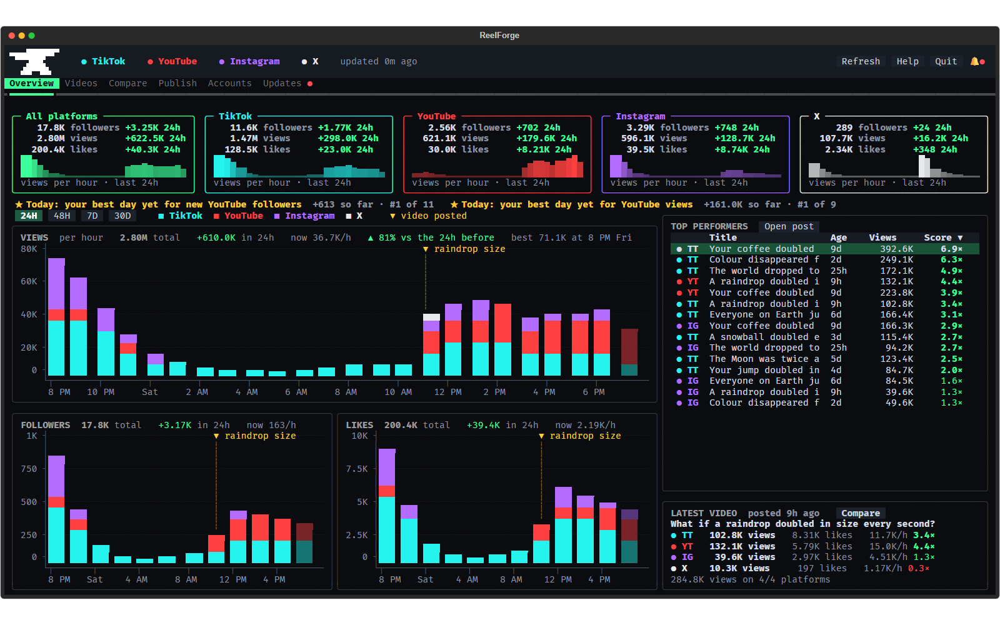

## What it makes

An AI made these three videos with ReelForge, start to finish: it wrote the script, checked every number against a
real source, built and rendered the 3D scenes, and added the text and the sound. They're ReelForge's three demos.

<p align="center">
  &nbsp;
  &nbsp;
  
</p>

You start from a format that's already pulling views, like "What if X doubled every 2 seconds?" or "What if everyone
on Earth did X at once?", or you describe your own.

## Quick start

You need a Windows 10 or 11 PC with a recent NVIDIA or AMD graphics card, about 15 GB of free space, and Claude Code
or Codex. (macOS and Linux work too, but they're experimental: see the [FAQ](#faq).)

1. **Open PowerShell.** Press the Windows key, type `PowerShell` and press Enter.
2. **Paste this line and press Enter.**

   ```
   irm https://github.com/dan2756/ReelForge/releases/latest/download/install.ps1 | iex
   ```

   It downloads the newest ReelForge straight from GitHub into `C:\Users\<you>\ReelForge`, checks it and starts
   setup, so neither your browser nor Windows shows a download warning.
3. **Say yes, then answer a few questions.** ReelForge lists what it still needs and, when you click **Set up**,
   downloads Blender, ffmpeg and the sound effects into its own folder. Then it asks about your channel: what it's
   about, the format, where you post, and how your videos should look and sound.

<p align="center">
  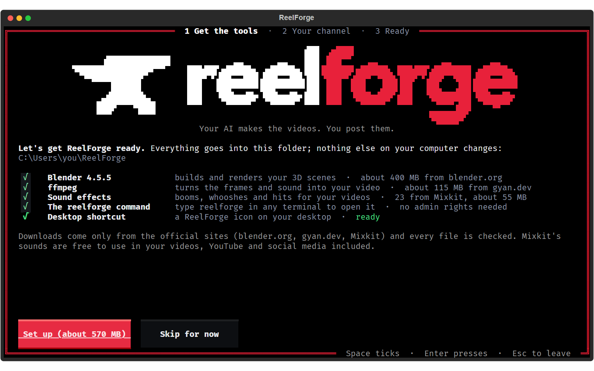
  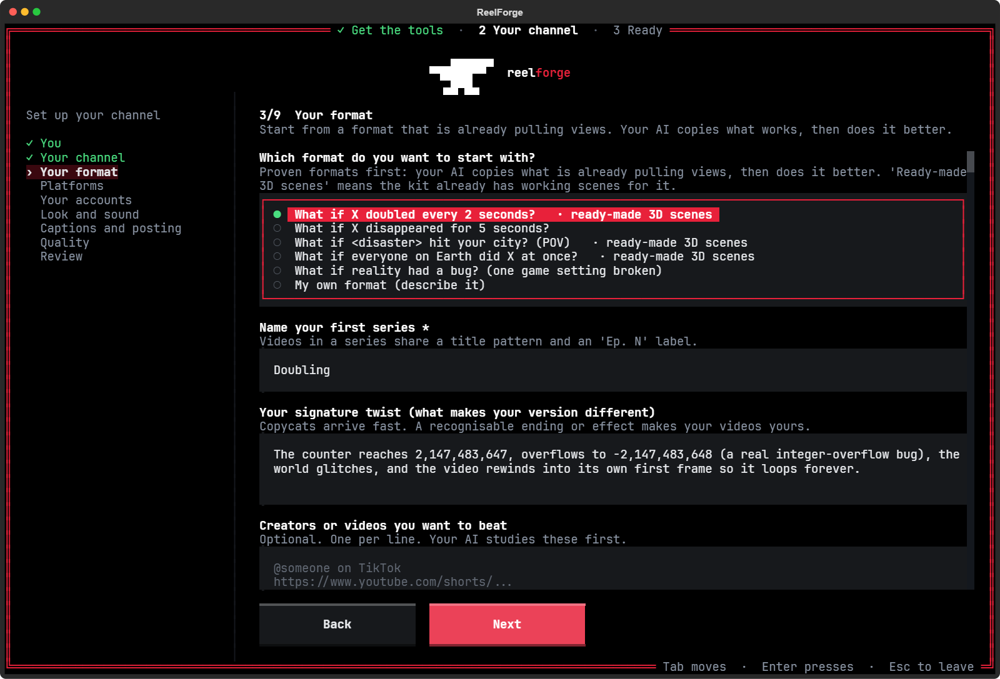
</p>

Rather use an installer? Open the [latest release](https://github.com/dan2756/ReelForge/releases/latest), click the
file that ends in `Windows-Setup.exe` under **Assets**, and open it. If Windows says "Windows protected your PC",
click **More info**, then **Run anyway**: it says that about new apps that aren't code-signed yet. Setup starts when
the installer finishes.

## Make your first video

Onboarding turns your answers into instructions for your AI, `CLAUDE.md` for Claude Code and `AGENTS.md` for Codex,
and saves them in the ReelForge folder (`C:\Users\<you>\ReelForge` unless you picked another). Its last screen tells
you what to do next.

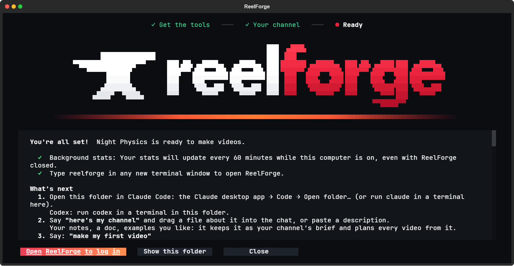

1. **Open the ReelForge folder in your AI.** In the Claude desktop app, go to **Code**, click **Open folder…** and
   pick the ReelForge folder (or run `claude` in a terminal inside it). For Codex, run `codex` in a terminal inside
   it.
2. **Ask for your first video** in the words that screen gives you:

   ```
   make my first video
   ```

3. **Let it work.** Your AI picks a subject, writes the script, checks the facts, builds the scene in Blender and
   renders it, adds the text and the sound, then watches the finished video and fixes anything that's off. Rendering
   takes from about 15 minutes to an hour on a fast graphics card.
4. **Post it.** Open ReelForge (type `reelforge` in any terminal, or double-click the ReelForge icon on your
   desktop) and go to **Publish**.

After that, say **make today's videos** whenever you want more.

## Inside ReelForge

ReelForge has six tabs. Open one straight from a terminal with `reelforge 1` to `reelforge 6`, or by name, like
`reelforge publish`.

### Overview

Followers, views and likes on every platform, hour by hour, with a mark where each video went up, plus your top
videos and how the latest one is doing. The bell at the top right collects milestones, new videos ready to post and
updates, and gets a red dot when there's something new. Click a notification to see what it's about: a video that's
taking off opens on the Videos tab, highlighted, and a finished video is picked out on Publish. The × at a
notification's right deletes it.

<p align="center">
  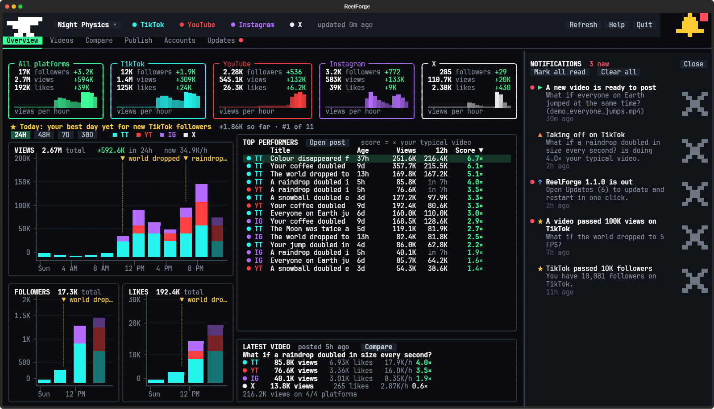
  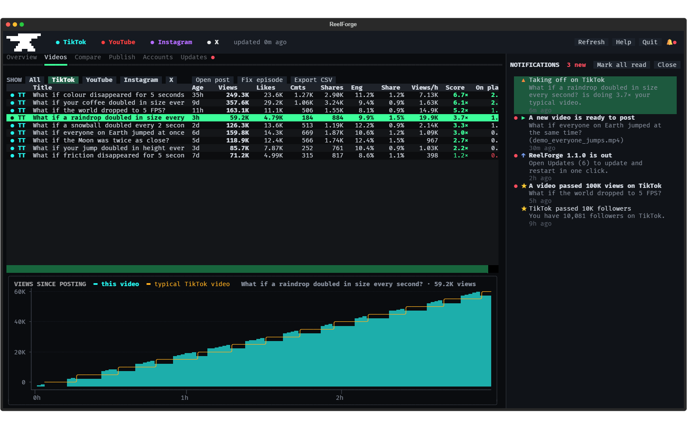
</p>

### Videos

Every video on every platform in one table, scored against your typical video. Click a header to sort, and pick a
video to see how its views grew after you posted it. Export CSV saves every video with when it went up (date,
weekday, hour and UTC time) and its views 1, 6 and 24 hours in.

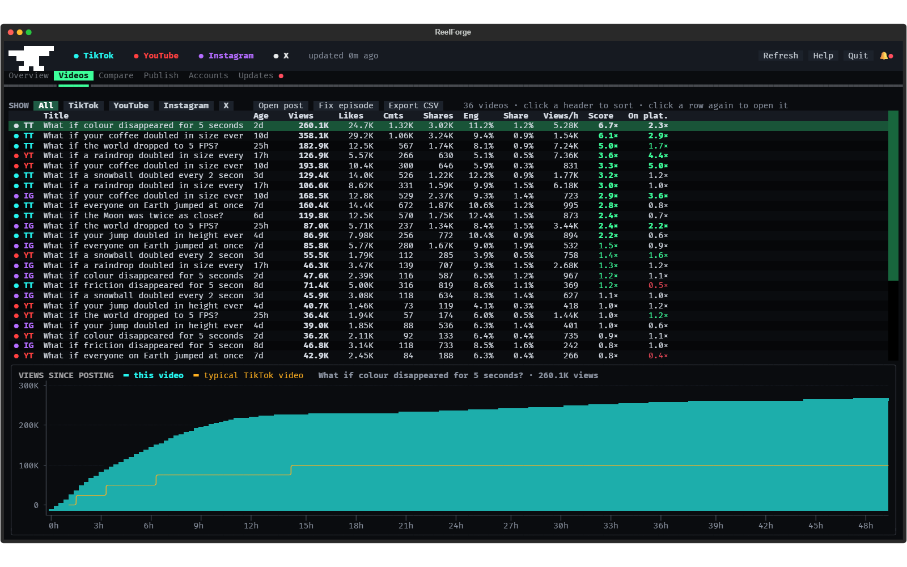

### Compare

Which platform is working for you: views per video, like rate and followers gained side by side, and how a typical
video grows over its first three days on each one.

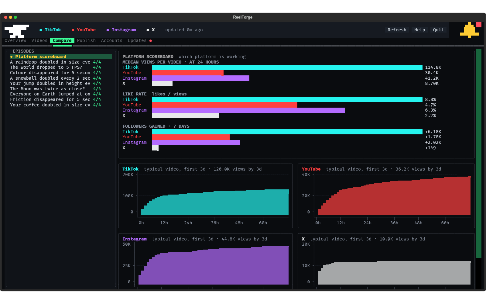

### Publish

Every finished video waits here with its post already written. Each platform's button opens that site's upload page
and copies exactly the text it needs, so you drag the video in and press Post. ReelForge spots the post by itself.
Under the list, Best time to post shows the part of the day your videos have done best in on each platform, by
their views in their first day, and when it next comes round, once there are enough videos to tell.

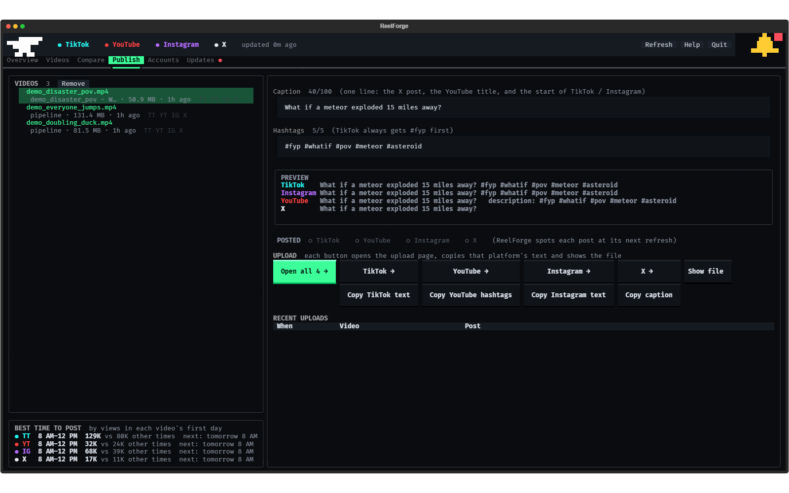

### Accounts

Where each platform's stats come from. TikTok and YouTube only need your handle. Instagram and X need you to log in
once, in ReelForge's own browser window. There are no API keys to set up.

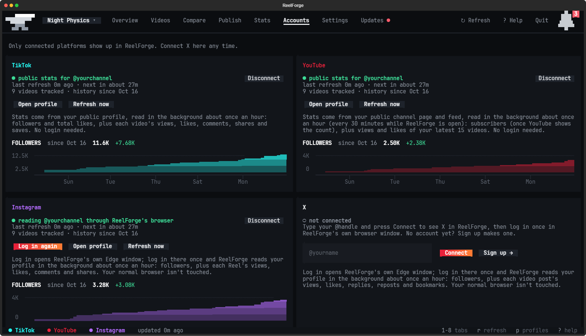

## Updates

When a new version is out, the bell gets a red dot and the **Updates** tab (`reelforge 6`) shows what's new. Click
**Update and restart** to install it. Your channel, videos, stats and settings stay as they are, and your AI's
instructions are refreshed for the new version.

<p align="center">
  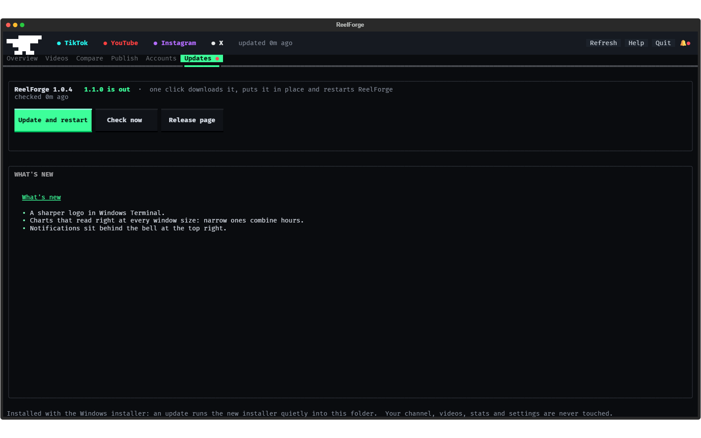
</p>

## FAQ

<details>
<summary><b>Windows says "Windows protected your PC". Is it safe?</b></summary>

<br>

Yes. Windows says that about new apps that aren't code-signed yet; it doesn't mean it found anything wrong. Click
**More info**, then **Run anyway**. Your browser may also warn that the file isn't commonly downloaded: open the
**⋯** menu next to the download, choose **Keep**, then **Keep anyway** (Edge asks you to click **Show more** first).

The one-line install in the [Quick start](#quick-start) doesn't go through your browser, so it skips both warnings.

</details>

<details>
<summary><b>Is ReelForge free?</b></summary>

<br>

Yes. ReelForge is free and open source. Making videos uses your own Claude Code or Codex plan.

</details>

<details>
<summary><b>Does it post for me?</b></summary>

<br>

No. ReelForge never posts, uploads or sends anything. Finished videos wait in the Publish tab, and you post them
yourself.

</details>

<details>
<summary><b>Can I install it somewhere else?</b></summary>

<br>

Yes, on any drive with room for your videos. Before you paste the install line, run this in the same PowerShell
window, with your own folder:

```powershell
$env:REELFORGE_DIR = "D:\ReelForge"
```

The installer asks you where to put it as you click through it.

</details>

<details>
<summary><b>Where are my videos?</b></summary>

<br>

In the Publish tab, and as files in the ReelForge folder: every video has its own folder in `episodes`, and a copy of
each finished one goes to `completed videos`.

</details>

<details>
<summary><b>Do my stats update while ReelForge is closed?</b></summary>

<br>

Yes, if you said yes during onboarding. Once an hour, while your computer is on, a small background job reads your
stats for about a minute, then stops. Turn it off or back on with `reelforge stats off` or `reelforge stats on`.

</details>

<details>
<summary><b>My AI doesn't know about my channel.</b></summary>

<br>

Make sure you opened the ReelForge folder itself, not the folder it's in: your AI reads `CLAUDE.md` (or `AGENTS.md`)
from there. If it still seems lost, run onboarding again with `reelforge onboard`.

</details>

<details>
<summary><b>How do I change my answers?</b></summary>

<br>

Run `reelforge onboard`, or open **Change my channel answers** from the Start menu. It starts from your last answers,
and when you finish it rewrites your AI's instructions and ReelForge's settings.

</details>

<details>
<summary><b>How do I get the best videos?</b></summary>

<br>

Use your strongest model at its highest effort. Onboarding sets Claude Code to Opus at max effort for the ReelForge
folder. If your Claude has ultracode, start a message with it, like `ultracode: make today's videos`, and the work is
split across a team of agents. With Codex, pick your strongest model with `/model` and the highest reasoning effort.

</details>

<details>
<summary><b>Can I try things in a second copy without touching my real one?</b></summary>

<br>

Yes. Unzip the Windows zip from the release into another folder and put a file called `TEST-COPY.txt` in it. That
copy's window says **TEST**, its stats, logins and settings are its own, and it never touches the `reelforge`
command, the hourly stats job or the desktop shortcut, which stay with your real ReelForge. Open it with its own
`ReelForge.bat`.

</details>

<details>
<summary><b>Something isn't working.</b></summary>

<br>

Run `reelforge doctor`. It checks everything ReelForge needs and says how to fix anything that fails. `reelforge
setup` repairs the setup.

</details>

<details>
<summary><b>Can I use it on a Mac or Linux?</b></summary>

<br>

Yes, but it's experimental: ReelForge is built and tested on Windows. Download the macOS zip or the Linux tar.gz from
the [latest release](https://github.com/dan2756/ReelForge/releases/latest). On a Mac, right-click
`Set up ReelForge.command` and choose **Open**. On Linux, run `./setup.sh`. Both need Python 3.11 or newer and ffmpeg
(on a Mac: `brew install python@3.13 ffmpeg`).

</details>

<details>
<summary><b>Which commands are there?</b></summary>

<br>

- `reelforge` opens ReelForge.
- `reelforge 1` to `reelforge 6` open a tab: Overview, Videos, Compare, Publish, Accounts, Updates.
- `reelforge onboard` changes your channel answers.
- `reelforge setup` sets up or repairs the tools.
- `reelforge doctor` checks everything.
- `reelforge stats on` and `reelforge stats off` turn the hourly stats on and off.
- `reelforge help` lists the rest.

</details>

<details>
<summary><b>How do I uninstall it?</b></summary>

<br>

If you used the install line (or a zip, or a Mac or Linux), run `reelforge stats off` and `reelforge command off`,
delete the ReelForge icon from your desktop, then delete the ReelForge folder. On Windows, also delete
`%LOCALAPPDATA%\Microsoft\Windows Terminal\Fragments\ReelForge`, ReelForge's profile in Windows Terminal.

If you used the installer, go to **Apps** in Windows **Settings**, find ReelForge and choose **Uninstall**. That
removes ReelForge, the tools it downloaded, the hourly stats job and the `reelforge` command, and keeps your channel,
videos and stats in its folder.

</details>

## License

ReelForge is free and open source under the [MIT license](LICENSE). Setup downloads Blender and ffmpeg from their
official sites and the Mixkit sound effects from Mixkit; the Kenney sound effects come with it. Details are in
[THIRD_PARTY.md](THIRD_PARTY.md).
