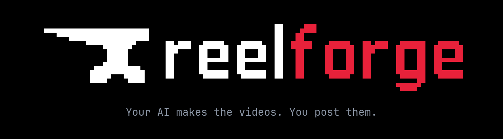
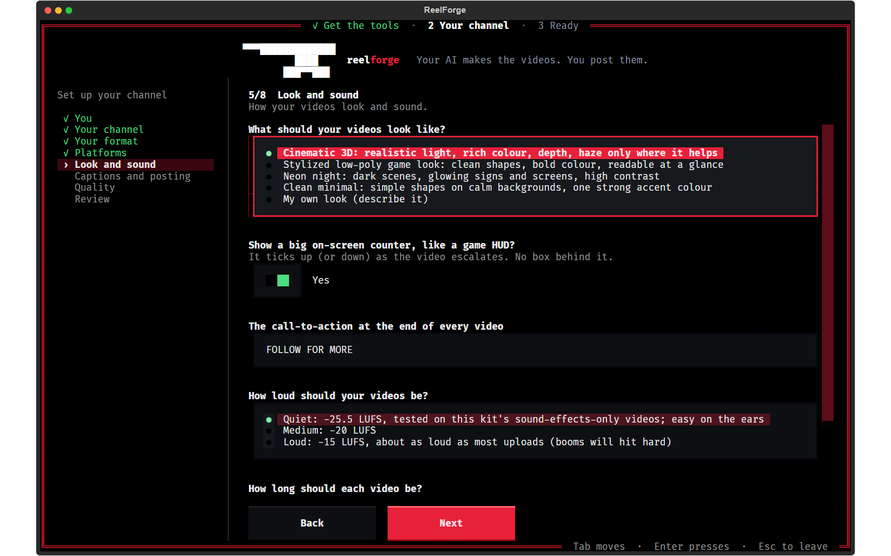
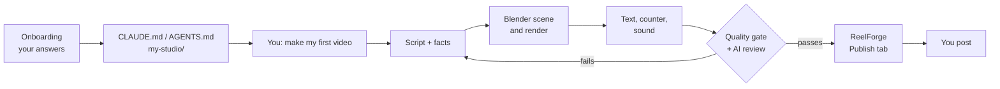

<div align="center">



### Your AI makes the videos. You post them.

A studio in a folder for faceless short-form channels on TikTok, YouTube Shorts, Instagram Reels and X.

[](https://github.com/dan2756/ReelForge/releases/latest)


[](LICENSE)

**[Download](https://github.com/dan2756/ReelForge/releases/latest)** ·
**[Quick start](#quick-start)** ·
**[See it](#see-it)** ·
**[How it works](#how-it-works)** ·
**[FAQ](#faq)**

</div>

<br>


<br>

ReelForge turns **Claude Code** (or **Codex**) into a production studio. You answer a short interview about your
channel. Then you ask for a video, and your AI writes the script, checks every fact, builds and renders a 3D scene in
Blender, adds the text, the on-screen counter and the sound, runs a quality check, and drops the finished video into
**ReelForge**, a window in your terminal where you see your stats and post by hand.

> [!NOTE]
> **Nothing is ever posted for you.** ReelForge makes the video and copies the caption; you press Post.

## Quick start

1. **Download** `ReelForge-…-Windows-Setup.exe` from the
   **[latest release](https://github.com/dan2756/ReelForge/releases/latest)**.
2. **Open it.** Windows may say "Windows protected your PC" because the installer isn't code-signed: click
   **More info**, then **Run anyway**. When it finishes, leave **Set up ReelForge now** ticked.
3. **Say yes once.** Setup opens in a box with the ReelForge logo, lists what it still needs (Blender, ffmpeg, the
   sound effects, the `reelforge` command) and sets it all up in the ReelForge folder when you press **Set up**.
4. **Go through onboarding.** It follows straight on: a short interview about your channel, your format, your
   platforms and your style.

That's it. When onboarding finishes it tells you the one thing to say to your AI:

```
make my first video
```

From then on, type **`reelforge`** in any terminal (or double-click the ReelForge icon) to open it.

<details>
<summary><b>macOS, Linux, or no installer</b></summary>

<br>

| Your computer | Download | Then |
|---|---|---|
| Windows, no installer | `ReelForge-…-Windows.zip` | Unzip it to a short path (e.g. `C:\Users\you\ReelForge`) and double-click `setup.bat`. |
| macOS (experimental) | `ReelForge-…-macOS.zip` | Unzip it, right-click `Set up ReelForge.command`, choose **Open**. Needs Python 3.11+ and ffmpeg (`brew install python@3.13 ffmpeg`). |
| Linux (experimental) | `ReelForge-…-Linux.tar.gz` | Extract it and run `./setup.sh`. Needs Python 3.11+ and ffmpeg. |

Onboarding starts when setup finishes. To run it again later: `reelforge onboard` (or `onboard.bat` /
`./onboard.sh`).

Prefer to do it all in chat? Open the folder in Claude Code before onboarding and say "set me up": your AI runs
setup with your OK and interviews you in the chat instead.

</details>

### What you need

| | |
|---|---|
| 🖥️ **A computer** | Windows 10 or 11. macOS and Linux are experimental. |
| 🎮 **A graphics card** | Any recent NVIDIA or AMD GPU. A 67-second video renders in 10–25 minutes on a fast one. |
| 💾 **Disk space** | About 3 GB for the tools, plus 10 GB free while rendering. |
| 🤖 **An AI that can run commands** | **Claude Code** (a paid Claude plan or an API account) or **Codex**. |

You don't need to know Blender, Python or video editing. Setup installs everything into the ReelForge folder.

## See it

### First run

Setup and onboarding happen in one box round your terminal: what ReelForge needs, one yes, the downloads with their
progress, a health check, then the interview. Your answers become your AI's instructions and your channel's
settings.

<table>
  <tr>
    <td colspan="2"></td>
  </tr>
  <tr>
    <td colspan="2" align="center"><sub><b>Get the tools</b>: everything goes into the ReelForge folder</sub></td>
  </tr>
  <tr>
    <td width="50%"></td>
    <td width="50%"></td>
  </tr>
  <tr>
    <td align="center"><sub><b>Your format</b>: start from one that's already pulling views, then make it yours</sub></td>
    <td align="center"><sub><b>Look and sound</b>: style, counter, loudness, length</sub></td>
  </tr>
</table>

### ReelForge

Your stats on every platform, and the Publish tab where every finished video waits for you. Six tabs; open one
directly with `reelforge 1` to `reelforge 6`, or by name (`reelforge publish`). `reelforge --demo` shows it with
made-up stats, like these screenshots.

<table>
  <tr>
    <td width="50%"></td>
    <td width="50%"></td>
  </tr>
  <tr>
    <td align="center"><sub><b>4 Publish</b>: each button opens the upload page, copies that platform's caption and shows the file</sub></td>
    <td align="center"><sub><b>2 Videos</b>: every video on every platform, scored against your typical one</sub></td>
  </tr>
  <tr>
    <td width="50%"></td>
    <td width="50%"></td>
  </tr>
  <tr>
    <td align="center"><sub><b>Notifications</b>: milestones, new videos ready to post, updates; a red dot when there's something new</sub></td>
    <td align="center"><sub><b>6 Updates</b>: a new version installs and restarts in one click</sub></td>
  </tr>
  <tr>
    <td width="50%"></td>
    <td width="50%"></td>
  </tr>
  <tr>
    <td align="center"><sub><b>3 Compare</b>: which platform is working, and one video side by side everywhere</sub></td>
    <td align="center"><sub><b>5 Accounts</b>: where each platform's stats come from, and the one-time log-ins</sub></td>
  </tr>
</table>

## What it does

- 🧭 **Starts from what works.** Onboarding offers formats already pulling views, and your AI re-checks what's
  trending before it picks subjects.
- ✍️ **Writes and fact-checks.** Every number on screen is checked against a real source, saved next to the video.
- 🎬 **Builds and renders in 3D.** Blender builds the scene and renders it; Python adds the title, the story lines,
  the counter and the sound; ffmpeg encodes a 1080×1920 video.
- ✅ **Won't ship a bad video.** An automatic quality gate checks length, black or frozen frames, the loop, loudness,
  harsh sound, overlapping text and caption rules. Then your AI watches it like a viewer and signs it off.
- 📊 **Tracks your stats without API keys.** ReelForge reads the same pages you'd look at: followers, views and
  likes per hour, your top videos, and how each new one is doing. An hourly background job keeps reading them while
  ReelForge is closed.
- 🙋 **Leaves posting to you.** The Publish tab copies each platform's caption and opens its upload page.

## How it works



<details>
<summary><b>The pieces</b></summary>

<br>

- **The pipeline** (`pipeline/`) turns one `episode.json` into a finished video. Commands for running a step by hand
  are in `docs/PIPELINE.md`.
- **The quality gate** (`pipeline/qa.py`) checks the final file. A video that fails can't ship.
- **Your AI's review** follows the quality bar in `docs/QUALITY.md` and checks every number in `facts.md`.
- **The ReelForge window** (`dashboard/`, guide in `dashboard/README.md`) is where your stats and finished videos
  live. Instagram and X stats need a one-time log-in in ReelForge's own Edge window; TikTok and YouTube just need
  your handle.
- **Setup and onboarding** (`studio/`) write your AI's instructions from your answers and keep the tools in place.

</details>

## Formats you can start with

| Format | The hook |
|---|---|
| **What if X doubled every 2 seconds?** | A number climbs past real milestones until the counter overflows and the video rewinds into a seamless loop. Ready-made 3D scenes included. |
| **What if X disappeared for 5 seconds?** | One thing vanishes and the world reacts. |
| **What if \<a disaster\> hit your city?** | First-person POV with a countdown and an end-card fact. Ready-made 3D scenes included. |
| **What if everyone on Earth did X at once?** | One action, eight billion people. Ready-made 3D scenes included. |
| **What if reality had a bug?** | One game-engine setting broken in the real world. |
| **Your own format** | Described in your words. |

## Everyday use

| | Any terminal | Or double-click |
|---|---|---|
| Make videos | say "make today's videos" to your AI | |
| Open ReelForge | `reelforge` | the ReelForge icon, or `ReelForge.bat` |
| Open a tab | `reelforge 4` or `reelforge publish` (1 overview · 2 videos · 3 compare · 4 publish · 5 accounts · 6 updates) | |
| Change your answers | `reelforge onboard` | `onboard.bat` / `./onboard.sh` |
| Set up or repair | `reelforge setup` | `setup.bat` / `./setup.sh` |
| Check everything | `reelforge doctor` | |
| Background stats on or off | `reelforge stats on` / `reelforge stats off` | |
| Everything else | `reelforge help` | |

**Make your AI work harder.** Onboarding sets Claude to **Opus** at **max** effort for this folder. For video runs,
start your message with **ultracode** (e.g. "ultracode: make today's videos") so the work is split across a team of
agents. With Codex, pick your strongest model (`/model`) and the highest reasoning effort.

## FAQ

<details>
<summary><b>Does it post for me?</b></summary>

<br>

No, never. Finished videos wait in the Publish tab. Each platform button copies the right caption, opens the upload
page and shows the file; you drag it in and press Post.

</details>

<details>
<summary><b>Do my stats update while ReelForge is closed?</b></summary>

<br>

Yes, if you said yes to it in onboarding. A small background job (Task Scheduler on Windows) wakes once an hour
while your computer is on, reads your stats in a hidden browser for about a minute, then exits; nothing runs in
between. Turn it off or on any time with `reelforge stats off` / `reelforge stats on`. Nothing is made up for hours
when the computer was off: they stay empty, and what you gained meanwhile still counts in your totals.

</details>

<details>
<summary><b>How do I update?</b></summary>

<br>

Open the **Updates** tab (`reelforge 6`). When there's a new version it shows what changed; **Update and restart**
installs it and reopens ReelForge. Your channel, videos and stats stay where they are, and your AI's instructions are
rewritten with the new version's.

</details>

<details>
<summary><b>Something's missing or broken.</b></summary>

<br>

Run `reelforge setup` (or `setup.bat`) again, then `reelforge doctor`. Every failed check says how to fix it.
`reelforge doctor --render-test` also builds a scene in Blender and renders a frame. If Blender or ffmpeg is
installed somewhere else, set `STUDIO_BLENDER` (or `STUDIO_FFMPEG`) to its path.

</details>

<details>
<summary><b>My AI doesn't seem to know my channel.</b></summary>

<br>

Make sure you opened the ReelForge folder itself (not a folder above it) and that `CLAUDE.md`'s first heading is
your channel's name. If not, run onboarding again.

</details>

<details>
<summary><b>The videos are too quiet or too loud.</b></summary>

<br>

Run onboarding again and pick another loudness. Don't change it per video.

</details>

<details>
<summary><b>How do I uninstall it?</b></summary>

<br>

Windows: **Settings → Apps → ReelForge → Uninstall**. It removes ReelForge, the tools setup downloaded, the hourly
stats job and the `reelforge` command, and keeps your channel (`my-studio/`, `episodes/`, `completed videos/`) and
your stats. With the zip, or on macOS/Linux: run `reelforge stats off` and `reelforge command off`, then delete the
folder.

</details>

<details>
<summary><b>What's in the folder?</b></summary>

<br>

| | |
|---|---|
| `my-studio/` | your answers, settings and channel bible (yours; never part of the download) |
| `episodes/` | one folder per video: `episode.json`, `facts.md`, the build files and `final/` |
| `completed videos/` | a copy of every finished video with its cover and captions, plus the production log |
| `dashboard/` | the ReelForge window: stats, notifications, publishing, updates (its data is in `dashboard/data/`) |
| `pipeline/` | the video pipeline: Blender scenes, text and sound, the quality gate |
| `studio/` | setup, onboarding, the health check and the `reelforge` command |
| `bin/` | the `reelforge` command itself |
| `examples/` | example episodes to start from |
| `docs/` | the pipeline, the quality bar, the sound rules, how to research a niche |
| `assets/` | the icon, fonts, and sound effects with their licences |
| `tools/` | Blender and ffmpeg, if setup downloaded them |

</details>

## Licences

The kit's code is MIT-licensed ([`LICENSE`](LICENSE)). Sound effects: Kenney (CC0, included) and Mixkit (free
licence, downloaded by setup on your computer because it doesn't allow redistribution). Blender (GPL) and ffmpeg are
downloaded from their official sites. Details in [`THIRD_PARTY.md`](THIRD_PARTY.md).
